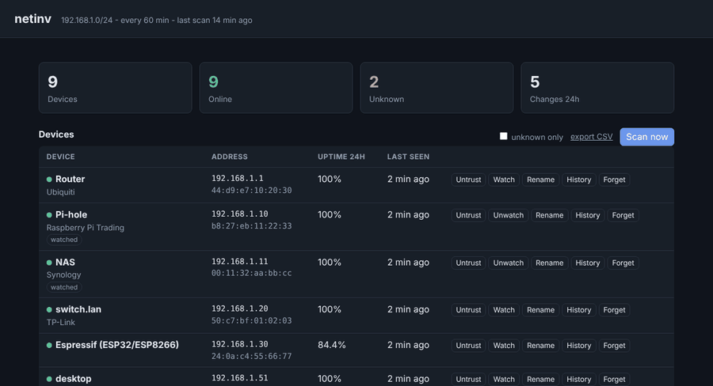
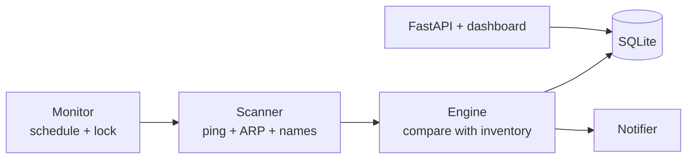

# net-inventory-monitor

[](https://github.com/TexAlphaWolf/net-inventory-monitor/actions/workflows/ci.yml)
[](LICENSE)




Finds every device on your network, remembers them, and tells you when something new shows up.

A home or small-office network changes all the time: a guest's phone, a new IoT gadget, a device
that quietly takes over someone else's address. netinv keeps an inventory, flags what you have not
approved, tracks uptime and sends a message (Telegram, webhook or email) when something changes.
It needs no root and no agent on the devices, and runs on Windows and Linux.

## Quick start

```bash
python -m venv .venv && source .venv/bin/activate     # Windows: .venv\Scripts\Activate.ps1
pip install -e ".[dev]"
cp .env.example .env                                   # set NETINV_SUBNETS to your network
netinv scan          # the first scan is the baseline: everything found is trusted
netinv devices
netinv run           # scans every 5 minutes, dashboard on http://127.0.0.1:8090
```

With Docker, on a Linux host (the scanner needs the real LAN, so the container uses host
networking; Docker Desktop on Windows or macOS cannot see the LAN, run `netinv run` there instead):

```bash
cp .env.example .env && docker compose up -d --build
```

## What it does

- **Discovers** devices with a ping sweep, the ARP table, SSDP, and optional TCP probes or nmap,
  then asks each device for its name (reverse DNS, mDNS, NetBIOS, SNMP) and looks up the vendor
  from its MAC address.
- **Detects changes**: new device, device offline or back (only for devices you *watch*, and only
  after several missed scans), device moved to another address, and a new device that took the
  address of a trusted one.
- **Dashboard**: devices with uptime, a history strip, change log; trust, watch, rename or forget
  a device; scan now; export CSV or JSON.
- **Notifies** through Telegram, a webhook (Slack-style or Discord) or email, with a severity
  filter and a rate limit.
- **Safe by default**: private ranges only, capped scan size, hostile-input parsers, localhost
  bind, optional tokens. See [SECURITY.md](SECURITY.md).

## How it works



Details and design decisions: [docs/architecture.md](docs/architecture.md).
All settings: [docs/configuration.md](docs/configuration.md).

## Commands

| Command | What it does |
|---------|--------------|
| `netinv run` | scan on a schedule and serve the dashboard |
| `netinv scan` | scan once and print what changed |
| `netinv devices [--unknown]` | the inventory |
| `netinv events` | change history |
| `netinv trust / untrust DEVICE` | mark a device as known (`all` for every device) |
| `netinv watch / unwatch DEVICE` | alert when it goes offline |
| `netinv label DEVICE "Name"` | name a device |
| `netinv forget DEVICE` | remove it |
| `netinv notify-test` | send a test message on every channel |
| `netinv oui-update` | download the full IEEE vendor list |

`DEVICE` is a MAC, an IP or a label.

## API

| Method | Path | Description |
|--------|------|-------------|
| `GET` | `/api/devices` | Inventory with uptime (`?unknown=true`) |
| `GET` | `/api/devices/{id}/history` | Up/down history |
| `GET` | `/api/events` | Change log (`?kind=`, `?limit=`) |
| `GET` | `/api/stats` | Totals, last scan, notification channels |
| `GET` | `/api/export` | `?format=csv` or `json` |
| `PATCH` | `/api/devices/{id}` | `trusted`, `watched`, `label` |
| `DELETE` | `/api/devices/{id}` | Forget a device |
| `POST` | `/api/scan` | Scan now |
| `GET` | `/health` | Liveness |

Interactive docs at `/docs`.

## Limitations

IPv4 only; devices behind a router have no MAC and are tracked by IP; MAC addresses can be forged;
Wi-Fi client isolation hides devices from the scanner. The full list is in
[docs/architecture.md](docs/architecture.md#known-limitations).

## Development

```bash
ruff check . && mypy && pytest --cov
```

See [CONTRIBUTING.md](CONTRIBUTING.md). The scanner's system calls are injectable, so the 200
tests run without a network; CI also runs them on Windows.

## License

MIT - Luca Tessitore
