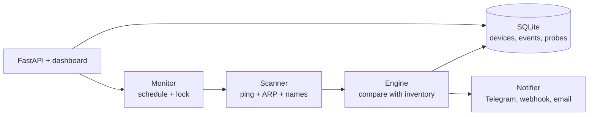

# Architecture

## Scanning

The default scanner needs no privileges and no extra software:

1. **Ping sweep** of every address with the system `ping`, 64 at a time. A reply counts only if it
   carries a TTL, because Windows exits 0 for "destination host unreachable".
2. **SSDP search** (multicast): TVs, speakers and routers announce themselves.
3. **Second ping** with a longer timeout for addresses that stayed silent (a phone in power-save
   sleeps through a quick ping), and optionally a TCP connect on a few ports.
4. **ARP table** of the machine. Pinging an address makes the OS resolve its MAC, so after a sweep
   the table lists every device that answered ARP, including those that ignore ICMP.
5. **Names**: reverse DNS, then mDNS (port 5353), NetBIOS (137) and optionally SNMP (161), each
   asked of the device itself.

`NETINV_SCANNER=nmap` replaces steps 1-4 with `nmap -sn`. This machine is not in its own ARP
table, so its MAC is read from the network interfaces.

Everything that touches the system (`ping`, `arp`, sockets) is injectable, so the parsers and the
logic are tested without a network. The parsers for hostile input (DNS, NetBIOS, SNMP) check every
length and offset and are tested against truncated and looping packets.

## Change detection

A device is identified by its MAC address, or by its IP when there is no MAC (hosts behind a
router). Each scan is compared with the stored inventory:

| Change | When |
|--------|------|
| `baseline` | the first scan of an empty database; everything found is trusted, nothing is reported |
| `new_device` | an unknown MAC appears (a randomised MAC is pointed out) |
| `ip_takeover` | a new device answers on the address of a trusted device that was online at the previous scan: an address conflict, or spoofing |
| `ip_changed` | a known device moved to another address |
| `device_offline` | missing for `NETINV_OFFLINE_AFTER` scans in a row, so a sleeping phone is not an incident |
| `device_online` | it came back |

Devices outside the scanned subnets are never marked missing, and one MAC answering on several
addresses is kept as one device (the others are listed in its details).

## Storage

Plain `sqlite3` with one short-lived connection per operation (the scanner thread and the web API
never share one), WAL mode, and a small versioned-migration list (`PRAGMA user_version`) instead
of an ORM. Three tables: `devices`, `events` and `probes` (one up/down row per device per scan,
the source of the uptime percentage and the history strip).

## Concurrency

One `Monitor` runs scans on a timer or on request, and a lock guarantees that two scans never
overlap (the API answers `409` if one is running). Notifications go through a bounded queue to
a worker thread, so a slow webhook cannot delay scanning. Run a single worker process.

## Known limitations

- **IPv4 only.**
- **One layer-2 segment gives MACs.** Devices on a routed subnet are tracked by IP, so a DHCP
  change looks like a new device. Run a scanner on each VLAN for full information.
- **MACs can be forged and randomised.** A forged MAC is indistinguishable from the real device;
  phones that rotate their private address show up as new devices (flagged as randomised).
- **Isolation hides devices.** If the router isolates Wi-Fi clients, or a guest network is
  separate, those devices cannot be seen from the scanning machine.
- **Docker Desktop on Windows or macOS** runs containers in a VM that cannot see the LAN; run
  `netinv run` natively there. Host networking on a Linux server works.
- macOS: the ARP table is not read yet.
